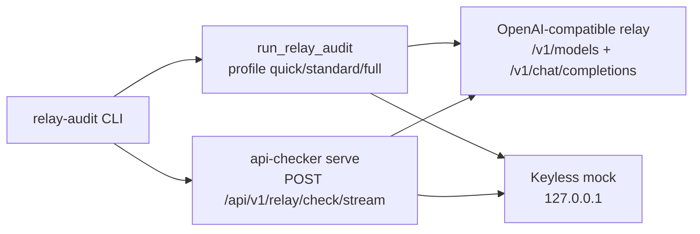

# minilab-aig-relay-audit

Built by SkilledDragon LLC — architecture-led software engineering — skilleddragon.com

Palette: `#020617` / `#040F49` / `#006BDF` / `#00BFA6`

**Audit lock (candado):** verify that the model behind an OpenAI-compatible relay is who it claims to be, using Tencent [AI-Infra-Guard](https://github.com/Tencent/AI-Infra-Guard) `v4.6.5` (`5ec95d4cd350f1982c0be71848463b07614e6e9d`) api-checker black-box audit.

## 1. What we built and why

Anthropic published [Strengthening our defenses against distillation attacks](https://www.anthropic.com/research/distillation-defenses) (2026-10-12). Vendor claims (hedge them): reasoning tokens extracted by distillers fell about 90–99%, a two-stage classifier runs at under 0.1% false positives, and tens of thousands of accounts were banned. The same week, [GitHub secret scanning started blocking Anthropic API keys by default](https://github.blog/changelog/2026-10-13-secret-scanning-blocks-anthropic-keys-by-default-adds-salesforce) (2026-10-13).

Builders face the mirror-image risk: a purchased relay may not forward to the model on the label. This lab is a repeatable **candado** — run the audit before you wire a third-party relay into an agent.

The lab wraps upstream algorithm C (8 probes via profiles `quick` / `standard` / `full`) through `run_relay_audit(...)`, plus the HTTP SSE `full` path (`algorithm=quick|full`) that can add random-number fingerprinting and Claude signature checks.

## 2. What we tested

| Suite | Command | Notes |
| --- | --- | --- |
| Upstream Go | `go build ./...` then `go test ./... -count=1` in `upstream/` | Verbatim from upstream `go-test.yml` at the pin |
| Upstream api_checker | `services/api_checker/.venv/bin/python -m pytest services/api_checker/tests -q` | Lab-owned job; 115 tests keyless at the pin |
| Lab keyless e2e | `uv run pytest -q` | Mock OpenAI on `127.0.0.1` + Python + HTTP paths |
| Skills / secrets / audit | CI jobs `skills-layout`, `secrets`, `audit`, `banned-phrases` | See [RESULTS.md](RESULTS.md) |

Real pass counts, durations, tool versions, and the CI run URL live in [RESULTS.md](RESULTS.md).

## 3. Setup

```bash
git clone --recurse-submodules https://github.com/SkilledDragonCorp/minilab-aig-relay-audit.git
cd minilab-aig-relay-audit
git -C upstream rev-parse HEAD
# must print 5ec95d4cd350f1982c0be71848463b07614e6e9d

uv sync --locked --group dev

cd upstream
python3 -m venv services/api_checker/.venv
services/api_checker/.venv/bin/pip install -r services/api_checker/requirements.txt
go build -o ai-infra-guard ./cmd/cli/main.go
export AIG_API_CHECKER_PYTHON="$PWD/services/api_checker/.venv/bin/python"
./ai-infra-guard api-checker list
cd ..

cp .env.example .env
# fill optional GEMINI_API_KEY / RELAY_* as needed
```

### Tutorial (keyless mock)

```bash
uv run pytest -q
```

Expected: all non-`live` tests pass. The Python path asserts `quick` → verdict `MEDIUM` score `50`, `full` → verdict `HIGH` score `100`. The HTTP path asserts `overall_verdict=risk` and `risk_level=high` when allow flags are set against the mock.

Against a relay you own:

```bash
export RELAY_API_KEY=...   # spend-capped
uv run relay-audit run --base-url "$RELAY_BASE_URL" --model "$RELAY_MODEL" --profile full --out reports/relay-audit.json
echo $?
```

Exit `0` only when verdict is `LOW` and findings are empty; exit `1` on findings / `MEDIUM` / `HIGH`; exit `2` on tool errors.

### Architecture



## 4. Using these skills in Claude Code and Cursor

Both Claude Code and Cursor auto-discover `.claude/skills/<name>/SKILL.md` from the repo root.

| Skill | Invoke |
| --- | --- |
| `audit-model-relay` | Ask the agent to follow `/audit-model-relay` before adding a third-party relay |

## 5. API keys

| Variable | Required | Where | Cost | Used by |
| --- | --- | --- | --- | --- |
| `RELAY_API_KEY` | For `run` / `run-http` | Your relay dashboard | Your relay pricing; use a spend-capped key | Lab CLI |
| `RELAY_BASE_URL` | Optional convenience | Your relay | — | Docs / shell |
| `RELAY_MODEL` | Optional convenience | Your relay | — | Docs / shell |
| `GEMINI_API_KEY` | Optional live slice | [Google AI Studio](https://aistudio.google.com/apikey) | Free tier | `relay-audit baseline --provider gemini` |
| `RELAY_AUDIT_ALLOW_LOCAL_HTTP` | Tests only | Lab | — | Allows `http://127.0.0.1` base URLs |
| `AIG_API_CHECKER_ALLOW_HTTP` | Tests only | Upstream serve | — | Permit `http://` targets |
| `AIG_API_CHECKER_ALLOW_PRIVATE_TARGETS` | Tests only | Upstream serve | — | Permit loopback/private targets |
| `AIG_API_CHECKER_MAX_JOBS` | Optional | Upstream serve | — | Concurrency cap |
| `AIG_API_CHECKER_LOG_LEVEL` | Optional | Upstream serve | — | Log level |
| `AIG_API_CHECKER_CORS_ORIGINS` | Optional | Upstream serve | — | CORS |
| `AIG_API_CHECKER_ROOT_PATH` | Optional | Upstream serve | — | OpenAPI root path only |
| `HOST` / `PORT` | Optional | Upstream serve | — | Bind address (lab uses `127.0.0.1:8000`) |
| `AIG_API_CHECKER_PYTHON` | After upstream venv | Lab/upstream | — | Python for Go wrapper |
| `LLM_API_KEY` | Not set by this lab | Upstream LLM features | — | Documented so you know the lab never sets it |

Identical names with empty values are in [.env.example](.env.example).

### Telemetry / analytics opt-outs (grep at the pin)

Command run at `5ec95d4cd350f1982c0be71848463b07614e6e9d`:

```bash
rg -n -i "telemetry|analytics|report_url|getenv\(|os.environ" upstream/cmd upstream/common upstream/services/api_checker | head -80
```

Findings for api-checker at the pin: configuration is via env vars (`AIG_API_CHECKER_*`, `HOST`, `PORT`, `AIG_API_CHECKER_DATA_DIR`, provider keys such as `OPENROUTER_API_KEY` / `DEEPSEEK_API_KEY` for other upstream tools). No separate product-telemetry toggle named `telemetry` or `analytics` appeared in that grep window. The HTTP `summary` step makes one extra upstream call to the tested model (upstream README at the pin). This lab never sets `LLM_API_KEY`.

## 6. License

Apache-2.0 for this lab. Upstream `Tencent/AI-Infra-Guard` is Apache-2.0; attribution to Tencent / Zhuque Lab as upstream authors. See [LICENSE](LICENSE) and the submodule at `./upstream`.
